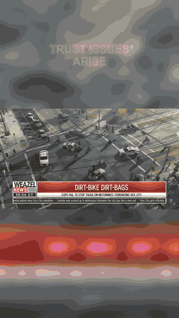

# Ninja Studio Clipping

**Paste a link. Get captioned 9:16 clips in about two minutes. Free and local.**

Ninja Studio Clipping turns long YouTube / Twitch / Kick videos (or your own MP4) into vertical, captioned clips with a title and hook for each. Everything runs on your machine: no subscription, no cloud processing.

[](https://www.instagram.com/amanat__official_)

Follow [@amanat\_\_official\_](https://www.instagram.com/amanat__official_) on Instagram for updates.



## Install

Requirements: Python 3.10 to 3.13 (the newest Python often has no wheels for the speech/vision packages yet; the Mac/Linux installer picks a supported one for you), FFmpeg on PATH. Optional but recommended: [Ollama](https://ollama.com) with `ollama pull llama3.2:3b` for AI titles, hooks and scores (without it clips are picked by the audio/motion score), and an NVIDIA GPU for NVENC and faster-whisper.

```bash
git clone https://github.com/Mdamanatansari7/neonclipping
cd neonclipping
# Windows
./run.ps1
# Linux / macOS
./run.sh
```

Open the address the app prints (normally <http://127.0.0.1:8770>; if that port is busy it picks the next free one), paste a link, press **⚡ Make clips**.

- **Windows one-click:** `NeonClipping-Setup.bat` installs Python and FFmpeg if missing, installs the app into `%LOCALAPPDATA%\NeonClipping`, creates a Desktop shortcut and opens the app.
- **Mac / Linux:** `install.sh`.

Optional GPU speech model support (only used when a video has no YouTube captions):

```bash
.venv/bin/pip install nvidia-cublas-cu12 "nvidia-cudnn-cu12==9.*"
```

Set `NEONCLIPPING_CPU=1` to force CPU. Set `NEONCLIPPING_PORT=9000` to use another port.

**Mac / Linux / no NVIDIA GPU:** the video encoder is chosen by what works on your computer: NVIDIA NVENC, then Apple VideoToolbox, then the CPU encoder (x264). Force one with `NEONCLIPPING_ENCODER=nvenc|videotoolbox|x264`.

**Settings (environment variables):** `NEONCLIPPING_LIVE_AUTO_HOURS` (default 3) and `NEONCLIPPING_MIN_FREE_GB` (default 8) control the unattended creator-watch live sessions; a manual Live clipping session has no time cap and no disk guard.

## How it finds good moments

**⚡ Fast mode (default, videos over 10 min)** never looks at the whole video:

1. Download **audio only** (79 MB for an 85-minute video, about 10 s).
2. Take the transcript from YouTube's own word-timed captions. For other sources a local Whisper model is used.
3. Score the audio for *sudden loudness jumps*, *raised voices* (2–4 kHz energy) and quiet-to-loud transitions.
4. A local LLM (Ollama) scores the best moments and writes a title and a hook. Start and end snap to sentence boundaries inside your Min/Max length.
5. Download **only the chosen sections** of the video and render 1080x1920 clips with burned-in captions.

**🔬 Deep mode** downloads the whole video, adds optical-flow motion and cut density to the audio signals, shortlists more candidates and gives the LLM more context.

| Signal | What it looks for |
|---|---|
| Loudness jump | A sudden boom or shout compared with the last two minutes |
| Raised voice | Energy in the 2–4 kHz band (screaming, yelling) |
| What is said | "oh my god", "run", "police", "bhaago", "arre yaar" and similar (English, Hinglish, Hindi) |
| On-screen action | Fast motion, explosion-like flashes, red/blue light flicker, scene cuts |
| AI score | A small local LLM reads the transcript: emotion, punchline, payoff |

**It learns from you.** Rate clips with the stars; ratings stay on your computer (`data/feedback.jsonl`) and tune the local ranking weights.

## Features

- One-click **Make clips**, live progress, clips appear one by one with preview and MP4 download.
- **Min / Max clip length** (e.g. 30–80 s). Clips end on a sentence.
- **11 native layouts** (camera above/below gameplay, blurred fill, full-screen crop, corner overlays, circle facecam, side-by-side), facecam presets and an automatic facecam finder.
- Caption styles: GTA Neon, Impact, Clean, Hormozi and MrBeast. Word-timed, editable words, SRT / WebVTT export, SRT/ASS import, 52 languages, Hinglish.
- **Opening headings**, templates (X post, TikTok hook, Breaking news), background card, logo / watermark, credit line, outro ribbon, music bed, six caption animations.
- **Edit saved clips:** change layout, captions, style or trim one clip or all clips of a video without downloading again.
- **Live clipping** of Twitch / YouTube Live streams around chat spikes, **Creators** list that clips a streamer automatically, and a **phone remote** (`NEONCLIPPING_LAN=1`, PIN protected).
- **AI parts:** split a long video's captions into parts for any free chatbot, paste the answers back, make clips from only those moments.

## My clips

- **Delete:** every clip has a 🗑 Delete button, and you can select several clips and press **Delete selected**. This removes the clip (and its older edited versions) from this computer only. A video already uploaded to YouTube stays on YouTube.
- **YouTube tag:** each clip shows **✓ Uploaded on YouTube** (with a *View* link), **⏳ Uploading**, **✕ Upload failed** or **○ Not uploaded**. The uploaded list is kept in `data/youtube/uploads.json`, so it survives restarts.
- **Upload many at once:** tick clips (or press **Select all** / **Select not uploaded**) and press **▶ Upload selected to YouTube**. They are queued and uploaded one after another with your default privacy and tags. Keep the app open until the tags turn green.

## Phone app (Android + iPhone)

`flutter_app/` is the **Ninja Studio** phone app. The PC still does the heavy work (download, captions, rendering, live encoding); the phone app is the remote and viewer over your Wi-Fi:

- **Create:** paste a link → Make clips (count, length, format, caption style, optional YouTube upload), live progress, play the clips.
- **My clips:** play, save / share to the phone, delete, upload to YouTube (one or select many), YouTube tags.
- **Go Live:** paste a link → Shorts 9:16 or Landscape live on your YouTube channel (automatic, no key), facecam found by itself or crop to fill, banner (changeable while live), 15 s test, stop. Uses the logo and banner of your last live on the PC.

**Phone only, no laptop (Android):** the whole engine (this same Python app) runs on the phone inside **Termux**:

1. Install the Ninja Studio APK and choose **Use this phone**. The **phone setup** screen opens and checks everything, each step with its own button: Termux (installs it from the Play Store when missing), the engine, notifications, and the battery settings for 24 h lives.
2. **Only the first time:** **Install engine** copies one line and shows how to paste it in Termux — long-press → Paste → Enter (`curl -s 127.0.0.1:8898/setup | bash`). It installs the engine (5–10 minutes) and comes back to the app by itself. The engine code comes from the app itself (no GitHub, no laptop).
3. After that the engine **starts by itself when the app opens** (or with **Start engine**), also after a phone restart, and a newer app updates it by itself (never in the middle of a live).
   - Termux from the **Play Store** takes no commands from other apps, so the setup puts a small helper (`~/ninjastudio-agent.sh`) in Termux that asks the app what to do. After a phone restart Termux opens for a second and the app comes back.
   - Termux from **F-Droid / GitHub**: allow *Run commands in Termux environment* in the setup and the engine starts without opening Termux.
4. For 24 h lives keep the phone on the charger; the setup's battery steps stop Android from putting Termux or the app to sleep. The engine keeps the phone awake while it runs and restarts by itself if it ever stops.

Building the APK: run `bash flutter_app/tool/pack_engine.sh` first (it packs the engine into the app), then `flutter build apk --release`.

On the phone there is no OpenCV, so the automatic facecam finder and motion scoring are not available (moments come from audio + transcript, face layouts fall back to crop). Video is encoded with the phone's hardware encoder (MediaCodec) when it works, otherwise x264. Connect YouTube once from the menu → *Open the full studio*.

**Pair with a PC instead:** start the PC app with phone access (`NEONCLIPPING_LAN=1 ./run.sh`), open *Live clipping → Phone access* on the PC for the address and the 6-digit PIN, and type both in the app. Phone and PC must be on the same Wi-Fi. The phone can only use these features with the PIN; YouTube login and settings stay on the PC.

**Build / run** (Flutter 3.47+):

```bash
cd flutter_app
flutter run                       # on a connected phone or a simulator
flutter build apk --release       # Android: build/app/outputs/flutter-apk/app-release.apk
open ios/Runner.xcworkspace       # iPhone: choose your Apple team under Signing, then Run
flutter test                      # unit tests
flutter test integration_test -d <device> --dart-define=PC=<pc address> --dart-define=PIN=<pin>   # whole app against a PC
```

## Go Live

The **🔴 Go Live** section (under step 01) streams a video live to **YouTube Live, Facebook, Twitch or any RTMP server**.

- **Source:** paste a video link (downloaded once, then streamed) or tick *Use the video loaded above*.
- **Shape:** **Shorts · 9:16** (vertical live, shown in the Shorts feed) or **Landscape · 16:9**. 720p or 1080p, 30 or 60 fps.
- **Layout and facecam:** Go Live follows **step 02 (Make it your format)** by itself, e.g. *Face + gameplay*. For a pasted link the app finds the facecam in the video (same finder as Make clips); with the video loaded above it uses the boxes you drew in step 03. A video without a facecam is cropped to fill the screen instead. You can also pick *Crop to fill* (with a Left ↔ Right crop position) or add your own facecam video from step 03.
- **Logo and banner:** upload a logo (corner, size), write banner text (colours, top/bottom) and/or upload a banner image. These can be changed **while you are live** with *Update logo & banner now*; viewers see it within a few seconds.
- **📺 My YouTube channel (automatic, default):** no stream key. The app creates the live on the channel you connected for uploads (title, description, Public / Unlisted / Private), streams the video, YouTube starts the live by itself when video arrives, and **■ Stop** ends it on YouTube too. A *Watch on YouTube* link appears while live. The first time, press **🔓 Allow live streaming** once (older logins only allowed uploads). The channel must have live streaming turned on in YouTube Studio (the first time YouTube can take up to 24 hours).
- **Stream key mode** (YouTube with a key, Facebook, Twitch, custom RTMP): paste the key; it is only kept on this computer if you tick *Remember*, and it is never shown in the status or logs.
- **🧪 Test 15 s** renders 15 seconds to a preview video without going live and tells you if the computer is fast enough.
- While live you see the time, video position, fps and bitrate. *Loop* keeps the live going. If the internet drops, it reconnects by itself (up to 5 times) and continues where it was. **■ Stop** ends the live.
- Only stream videos you own or have permission to use; platforms strike channels for re-streaming other people's videos.

## YouTube upload

Press **▶ Connect YouTube** at the top, add your own Google Cloud *OAuth 2.0 Client* (`client_secrets.json`) and authorise your channel. Then upload a single clip with **▶ Upload to YouTube**, select several in My clips, or turn on auto-upload so Make clips posts every finished clip.

## "Sign in to confirm you're not a bot" (YouTube bot check)

The app keeps yt-dlp fresh (turn off with `NEONCLIPPING_NO_AUTOUPDATE=1`) and retries other YouTube clients. If YouTube still blocks you:

| Fix | How |
|---|---|
| **Upload the MP4** | Use **Upload video** next to the link box. Always works. |
| **Use your browser login** | Sign in to YouTube in Chrome, then start the app with `NEONCLIPPING_COOKIES_BROWSER=chrome`. |
| **Use a cookies file** | Save `cookies.txt` as `data/youtube_cookies.txt` (or point `NEONCLIPPING_COOKIES_FILE` at it). |
| **Change network** | Home Wi-Fi instead of mobile data; turn the VPN off. |

## Report a problem

The **Report a problem · समस्या बताएँ** button lets the user download a redacted diagnostics file (links, user names, e-mails and IPs removed) or, if a collector URL is configured (`tools/report-worker`), send it directly after ticking a consent box. Nothing is sent automatically.

## How it is built

| File | Job |
|---|---|
| `app.py` | FastAPI server, `/make` pipeline, export, library, clip delete |
| `youtube_uploader.py` | YouTube connect, single and batch uploads, uploaded list |
| `smart.py` | Moment scoring: transcript + local LLM, sentence snapping |
| `highlights.py` | Audio-jump / shout / optical-flow / cut ranking |
| `captions_yt.py` | YouTube word-timed captions parser |
| `captions.py` | Local Whisper (GPU first, CPU fallback), ASS/SRT styles |
| `translit.py` | Devanagari → Hinglish |
| `standalone.py`, `previews.py` | Link import, early preview frames |

## Tests

```bash
python -m unittest discover -s tests -v                      # portable unit tests
python tests/e2e.py static export edit creators feedback      # server must be running
```

## Honest limits

- Highlight picking is a heuristic plus a small local LLM. It finds loud, energetic, quotable moments, not guaranteed "viral" ones. Review before posting.
- Without YouTube captions (Twitch VODs, uploaded files) a speech model must transcribe each candidate, which is slow on CPU.
- One live session at a time, and the computer must stay awake and online while it records.
- Captions are drawn with fonts installed on your computer; right-to-left languages have basic support only.

## Credits

Built on FFmpeg, yt-dlp, FastAPI, faster-whisper, OpenCV (YuNet face detector, MIT) and Ollama. Design ideas studied from open-source clippers such as [PeakCut](https://github.com/haziqahmedqasmi/PeakCut), [ClipCutter](https://github.com/curtyo18/ClipCutter) and [content-ai](https://github.com/buddah0/content-ai).

## License

MIT. See [LICENSE](LICENSE).
